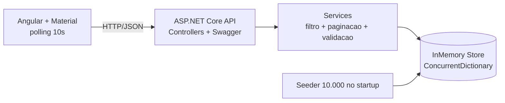

# Arquitetura mínima — Cadastro de Pedidos (MC1)

Proposta de arquitetura adequada ao prazo sugerido (2 a 3 horas). O objetivo é um
código organizado como em um projeto real, porém enxuto. Lembrete: o enunciado afirma
que **não há arquitetura "certa" esperada** — as escolhas abaixo são nossas.

## Visão geral

Dois serviços, orquestrados por `docker-compose`:

- **API** (ASP.NET Core / .NET 10) — expõe o CRUD, filtro e paginação.
- **Frontend** (Angular + Angular Material) — consome a API e apresenta a interface.

## Componentes do backend e responsabilidades

| Componente | Responsabilidade |
|-----------|------------------|
| `Domain` | Entidade `Pedido`, `PedidoItem` , `Produto` e enum `StatusPedido`. Sem dependências de framework. |
| `Dtos` | Objetos de entrada/saída (ex.: criar, atualizar, resposta, resultado paginado) com validações (DataAnnotations). |
| `Services` | Regras de aplicação: filtro por texto, paginação, orquestração de CRUD, mapeamento entidade↔DTO e validações de negócio. |
| `Infrastructure` | Store em memória thread-safe (`ConcurrentDictionary`) e o *seeder* que gera 10.000 pedidos no startup. |
| `Controllers` | Endpoints REST, tradução de resultados em status HTTP e `ProblemDetails`. |
| `Program.cs` | Composição: injeção de dependências, CORS, Swagger/OpenAPI e disparo do seeder. |

### Decisões-chave do backend

- **Store em memória**: `ConcurrentDictionary<Guid, Pedido>` garante operações seguras
  sob concorrência (RF3) sem locks manuais na maioria dos casos.
- **Seeding no startup**: 10.000 pedidos com dados variados e determinísticos (seed fixo
  de `Random`), para que o filtro por texto seja demonstrável (RF4, RF2).
- **Validação**: DataAnnotations nas DTOs + `ModelState` automático retornando `400`
  em formato `ProblemDetails` (RF7).
- **Paginação/filtro**: aplicados no `Service`; resposta inclui itens, total, página e
  tamanho da página, para a UI renderizar o paginador.
- **Timestamps**: toda entidade de domínio (`Pedido`, `PedidoItem`, `Produto`) possui
  `CreatedAt` e `UpdatedAt`; `CreatedAt` cumpre o requisito de "data de criação" e
  `UpdatedAt` é atualizado a cada modificação.
- **Status do pedido**: alterado por um **endpoint dedicado** (ex.: `PATCH
  /pedidos/{id}/status`), separado do update completo do recurso.

## Componentes do frontend e responsabilidades

| Componente | Responsabilidade |
|-----------|------------------|
| Serviço HTTP | Comunicação com a API (listar com filtro/paginação, obter, criar, atualizar, excluir). |
| Modelos (interfaces) | Tipos `Pedido`, `PedidoItem` , `Produto`,`StatusPedido`, resultado paginado. |
| Componente de lista | Tabela com filtro, paginação e ações de editar/excluir; dispara o polling de 10s. |
| Componente de formulário | Criação e edição com validação e exibição de mensagens de erro. |

### Decisões-chave do frontend

- **Angular Material** para tabela, paginador, formulários e feedback (snackbar/erros).
- **Polling de 10s** com RxJS (`interval` + `switchMap`), sem recarregar a página (RF6),
  tomando cuidado para **não** sobrescrever um formulário aberto durante o refresh.

## Execução (Docker)

- `docker-compose.yml` com **2 serviços**: `api` e `frontend`.
- Frontend servido por um servidor estático (ex.: Nginx) após o `ng build`; a API em seu
  próprio container. Subida com **um único comando**: `docker compose up`.
- **Sem segredos** nos arquivos de configuração.

## Alternativas consideradas e justificativa

| Tema | Alternativas | Escolha | Por quê |
|------|-------------|---------|---------|
| Frontend | React, Vue, **Angular** | **Angular + Material** | Decisão aprovada; Material resolve a estilização |
| Versão .NET | 6, 8, **10** | **.NET 10** | Disponível no ambiente; enunciado pede ≥ 6 |
| Empacotamento Docker | Imagem única (API serve estáticos), **compose 2 serviços** | **compose 2 serviços** | Separação clara API/UI; `compose up` é o "comando único" |
| Store | `List` + lock, **`ConcurrentDictionary`**, cache | **`ConcurrentDictionary`** | Thread-safe e simples (RF3) |
| Atualização da UI | **Polling**, SSE, WebSocket | **Polling 10s** | Enunciado só pede "sem recarregar"; polling é suficiente |
| Estilo da API | Minimal API, **Controllers** | **Controllers** | Organização clara para CRUD e testes |
| Validação | **DataAnnotations**, FluentValidation | **DataAnnotations** | Menos dependências; suficiente para validações básicas |
| Atualização de status | Update completo, **endpoint dedicado** | **endpoint dedicado** | Operação explícita e segura para mudança de status |
| Escopo de testes | Backend + frontend, **só backend** | **só backend** | Foco no risco de concorrência; cabe no prazo |

## O que fica de fora (por prazo/escopo)

Banco de dados, autenticação, CI/CD e observabilidade avançada não fazem parte do
escopo. Ver [requisitos.md](requisitos.md) seção "Fora de escopo".
